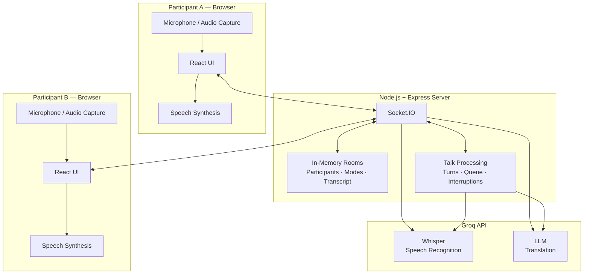
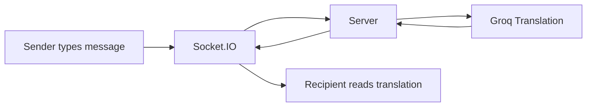
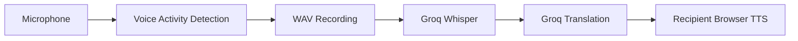

# The Table

Two seats. Two languages. One conversation.

The Table is a real-time conversation app for two people who don’t share a language. Each person chooses English or Hindi, joins the same room, and communicates through translated text or speech.

Instead of repeatedly switching between translation tools, both people can stay in one conversation, reading messages and hearing spoken translations in their preferred language.

Live: https://the-table-iva0.onrender.com

## How It Works

The Table has two conversation modes:

* Chat: Type a message and the other person receives its translation. Optional microphone dictation fills an editable message composer.
* Talk: Speak into your microphone. After a natural pause, the app transcribes and translates your words, then speaks the translation on the other person’s device.

Both modes use the same conversation transcript. Switching between them requires the other participant’s approval.

## System Architecture

The application uses React and TypeScript on the frontend, Node.js and Express on the backend, and Socket.IO for real-time communication.

A single server manages rooms, participants, conversation state, and AI requests. Microphone capture and speech playback happen in each participant’s browser.



Communication: The browsers exchange events with the server through Socket.IO. The server calls Groq over HTTPS for transcription and translation. Translated speech is generated locally using the listener’s browser speechSynthesis API.

## Chat Flow



The server creates a transcript entry, translates the message into the recipient’s language, and synchronizes the result with both participants.

The sender sees their original message. The recipient sees the translation and can expand Original to view the source text.

Chat also supports microphone dictation: recorded speech is transcribed with Whisper and placed in the composer for review before sending.

For Hindi Chat, the server can restore supported Romanized Hindi input to Devanagari before translation.

## Talk Flow



Talk uses an AudioWorklet and energy-based voice activity detection to identify spoken turns. After a pause, the browser sends the recorded audio to the server for transcription and translation.

The recipient hears the translated text through browser speech synthesis. Both participants also see the spoken turn in their transcript.

Interruption handling: If the listener starts speaking during playback, the app can stop the current speech, invalidate the interrupted processing job, and transfer the conversation floor. Interrupted lines are marked in the transcript.

Talk is pause-based, not simultaneous interpretation. Headphones are recommended to reduce audio feedback.

## Rooms and Conversation State

Each room has a six-character code and a maximum of two participants.

Socket.IO synchronizes messages, presence, mode changes, and transcripts. A mode switch is proposed by one participant and accepted or declined by the other.

Rooms and transcripts are held in server memory. An unexpected disconnection has an 8-second reconnection grace period. Participants can rejoin a room that still exists, and the transcript continues updating.

History is limited to the latest 200 entries per room snapshot and does not survive a server restart.

## Technology Stack

| Technology | Purpose |
| --- | --- |
| React 19 + TypeScript | Frontend and shared type safety |
| Vite 6 + Tailwind CSS 4 | Build tooling and responsive styling |
| Node.js + Express 5 | Backend and production frontend hosting |
| Socket.IO | Real-time messaging and room synchronization |
| Groq Whisper | Speech-to-text transcription |
| Groq LLM | English–Hindi translation |
| Web Audio API + AudioWorklet | Audio capture and voice activity detection |
| Browser speechSynthesis | Spoken translation playback |
| Node.js test runner | Automated backend and integration tests |
| Render | Application deployment |

Default AI models: whisper-large-v3 for transcription and openai/gpt-oss-20b for translation.

## V1 — Implemented Features

* Two-person rooms with shareable codes and links.
* English ↔ Hindi translation.
* Real-time Chat with typing indicators and original-message viewing.
* Microphone dictation into an editable Chat composer.
* Romanized Hindi script restoration in Chat.
* Talk with pause-based speech recognition, translation, and audible playback.
* Voice activity detection and interruption handling.
* Shared Chat/Talk transcript with translation and interruption statuses.
* Shared mode switching with accept/decline controls.
* Participant presence, explicit leave, and reconnection handling.
* Responsive interface and microphone, connection, and translation error feedback.

## Engineering Trade-offs and V2 Roadmap

V1 prioritizes a working two-person experience with a simple deployment architecture.

| V1 Limitation | V2 Direction |
| --- | --- |
| Speech is processed after a pause, adding latency. | Streaming speech recognition and incremental translation. |
| Browser TTS depends on available system voices, particularly for Hindi. | Dedicated multilingual, low-latency speech synthesis. |
| Energy-based voice detection can be affected by noise and speaker feedback. | Stronger speech detection, echo handling, and more precise barge-in. |
| Only English and Hindi are supported; code-switching is limited. | Additional languages and per-utterance language detection. |
| Rooms and transcripts exist only in server memory. | Persistent storage with retention and privacy controls. |
| Reconnection depends on a short grace period and tab-scoped identity. | Recoverable sessions and more robust room restoration. |
| A single server owns all room state. | Shared state and a distributed Socket.IO adapter for scaling. |
| Room codes are the primary access mechanism; no accounts or rate limiting. | Stronger access controls, request limits, and abuse prevention. |
| Speech quality and latency are not continuously measured. | Observability, performance metrics, and automated speech/translation evaluations. |

These improvements are future scope, not functionality claimed for V1.

## Project Structure

```text
the-table/
├── client/
│   └── src/
│       ├── audio/          # Recording, VAD, WAV encoding, TTS
│       ├── components/     # Chat, Talk, transcript, mode controls
│       ├── screens/        # Landing, waiting, conversation
│       ├── state/          # Participant and room state helpers
│       └── App.tsx         # App lifecycle and Socket.IO events
├── server/
│   ├── src/
│   │   ├── index.ts        # Express and Socket.IO setup
│   │   ├── socket.ts       # Real-time event handlers
│   │   ├── room.ts         # In-memory room management
│   │   ├── talk.ts         # Spoken turns and interruptions
│   │   └── groq.ts         # Transcription and translation APIs
│   └── test/               # Automated tests
├── shared/
│   ├── types.ts            # Shared contracts
│   └── roomSync.ts         # Transcript and presence utilities
├── .env.example
├── package.json
└── render.yaml
```

## Local Development

Requirements: Node.js 20+, npm, and a Groq API key.

### 1. Clone and install

```bash
git clone https://github.com/rchaithali/the-table.git
cd the-table
npm install
```

### 2. Configure environment variables

Copy .env.example to .env in the project root.

```bash
cp .env.example .env
```

Configure:

```env
GROQ_API_KEY=your_groq_api_key
GROQ_TRANSLATE_MODEL=openai/gpt-oss-20b
GROQ_WHISPER_MODEL=whisper-large-v3
PORT=4822
```

GROQ_API_KEY is required for transcription and translation. The model variables and port have defaults.

Keep .env private. Never commit API keys.

### 3. Start development servers

```bash
npm run dev
```

* Frontend: http://127.0.0.1:4821
* Backend: http://127.0.0.1:4822
* Health check: http://127.0.0.1:4822/health

Vite proxies Socket.IO and health requests to the backend during development.

### 4. Build and verify

```bash
npm run typecheck
npm test
npm run build
```

To serve the production build locally:

```bash
npm start
```

## Deployment

The Table is deployed on Render as one Node.js web service. Express serves the built React frontend and Socket.IO from the same origin.

Configuration is defined in render.yaml.

Build command:

```bash
npm ci --include=dev && npm run build
```

Start command:

```bash
npm start
```

Health endpoint: GET /health

The production environment requires GROQ_API_KEY. The server uses the PORT provided by Render.

Because room state is in memory, a service restart or spin-down clears active rooms and transcripts.

Live application: https://the-table-iva0.onrender.com

## Testing

The project uses Node.js’s built-in test runner with tsx.

Automated tests cover room lifecycle, messaging, translation handling, Hindi script restoration, mode switching, transcript synchronization, reconnection, spoken-turn processing, interruption handling, audio utilities, and error cases.

Groq requests are mocked in the automated tests. Actual microphone capture, browser speech synthesis, installed voices, and live speech quality require manual browser testing.

```bash
npm test
```

---

Two seats. Two languages. One conversation.
